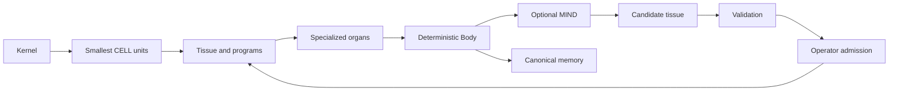

# Architecture

MantleOS is the creator's experimental testbed for AI embodiment through code.
Its experiments test functional organization, optional cognition, memory,
continuity and preservation through reviewed change.

MantleOS grows from a practical rule: established behavior must survive absent
or failed cognition. The Body owns state, admission, and effects. A replaceable
MIND helps choose what to propose. This release makes that loop concrete without
requiring a resident service or a model account.

## One composition model

These are views of composition and agency, not five independent runtimes.
The diagram describes the reference organism. The framework's shared contracts
also support simpler software, host integrations, AppAI, and Engram applications;
they do not require every expression to have cognition, identity, or a scheduler.
A CELL is the smallest organism unit produced by its kernel. RGB pixels and
append-record segments use different representations of that same concept.
The `cells` module validates kernel units; Chroma checks pixel framing and Engram
append validates each new segment. Programs, dependencies and executable profiles
belong to `tissue`, above those units.

KPP is the independently maintained development protocol. Recipe/3 retains its
shared Neutral Anchor binding. Recipe/4 has general measurable obligations and
defaults to no Anchor binding; explicit shared-neutral binding uses the same
authoritative definitions. The compatibility key anchors does not impose an
Anchor model on an unbound recipe. Language intent and available execution paths
are reported separately; declaration is not test evidence or acceptance.

KPP's complete workflow is part of `mantleos.kpp`: recipe validation, Pantry,
workspace/admission, progressive browser tools, Reflex staging/testing/transport,
GUI evidence, Chase and Baker acceptance. The standalone KPP project is generated
from the same canonical `mantleos` source; its `kpp` namespace aliases those
modules. `docs/kpp.md` and standalone `SYSTEMS.md` are byte-identical views of
one common document. Export and drift checks prevent silent source divergence.

Chat construction uses the shared `mantleos.kpp.build` preview-first contract and
bounded Chase driver. A small current work packet derives remaining obligations
from the existing recipe graph; it is not another writable requirements model.
The host opens a useful BUILDING slice before refinement and preserves its state
as modules arrive. Current evidence and explicit Baker acceptance still gate recipe
completion. Carried Bodies include the same preview assets and KPP CLI. See
[Canvas construction](canvas-builds.md) for the host sequence and limits.

Program profiles are `EMIT_TEXT/0.2` (KPP's canonical primer) and
`NOTEPAD_LLM/1.3`; the hosted `AGENTIC/0.2` profile remains separate execution
behavior under the same Anchor model. Undefined semantics are rejected.

The default Body retains five inherited system groupings for compatibility.
The registry no longer mandates five. Organ boundaries follow responsibility:
input and context, deterministic work, memory, verification, and checked output.
A dormant MIND port does not require a Brain organ. The older nine-organ anatomy
remains documented heritage rather than a second active runtime.

## Representation and location

| Concern | Responsibility | Current mechanisms |
| --- | --- | --- |
| Meaning | Interpret a declared semantic edition | Qualified Anchor profiles and self-contained app documents |
| Carrier | Package a verified Body snapshot | Cartridge ZIP, ChromaMem v5 PNG |
| Working state | Execute, admit, query, checkpoint | Body files, Engram ledger, derived compiled indexes |
| Cold memory | Retain and selectively retrieve older objects | Content-addressed `.rvcar` archive |
| Replication | Preserve a verified sequence elsewhere | Immutable segments, revision-checked head, local reference store |

Chroma's RGB tape and original VCW's RGBA layers have different meanings and
framing. Neither is silently reinterpreted as the other. Cloud segments carry
records, not an executable Body. Restoration requires an identity-matching
base with a matching history prefix. A missing segment or divergent prefix
blocks restoration. Tissue changes require a corresponding full snapshot.

Current anatomy is `ANATOMY.json` (`mantle.anatomy/1`), a whole-cartridge
description. It is not called a CELL. `mantle.cell/2` records a kernel's smallest
unit; `mantle.program/1` and `mantle.tissue/2` record executable composition.
The older misleading names are replaced explicitly without migration aliases.

## Authority and evolution

`evolution.propose` binds a validated candidate to the current compiled Body
revision. Validation provides scoped evidence, not permission. `apply` requires
the operator-selected proposal digest and repeats validation under the Body
lock. This release permits payload revisions within the same program membership,
profiles, dependencies, and capabilities. Structural or authority changes need
new construction, not an expanded self-issued grant.

Admission stages the complete candidate, refreshes the inherited compiled
contracts, appends an admission record, verifies, and publishes through the
existing transaction journal. Unchanged notebook state survives. Changed program
state is reset rather than silently carried into different semantics.

Rollback restores the latest active predecessor tissue and appends a rollback
record. It retains intervening memories and does not rewrite the sealed Primer.
Failed publication retains its recovery journal and verified prior generation.
The operator invokes `recover` before further work. Rollback folders are local
recovery checkpoints; retention/pruning is a future explicit maintenance policy.

## Resident AppAI and portable representatives

`appai` installs eight pinned, reversible connections into the actual Hermes
host. SELF and NEST both span the whole installation; `mantle/` contains owned
system files and ignored private state. `specimens` constructs fresh Engrams or
Bio-Agents. `examples` supplies recipes rather than another runtime. The
distinctions and commands are in [working examples](examples.md).

`missions` stores operator standing policy and durable dispatch/result state in
a resident SQLite database. Each child has an independently verified Body,
separate identity, exact inherited PRIMER, blank initial experience, and a
separate mission document. The resident launches a bounded read-only scanner
worker without forwarding credentials. It releases its lock during observation.
Returned evidence awaits digest-bound admission; the parent appends selected
findings and provenance without replacing its history. Admission never grants
capabilities. Interrupted work requires explicit recovery.

Cartridge and Chroma carry the child's Body and subsequent experience. The
policy database stays in the parent NEST. AppAI Body export is not whole-host
migration. Neither transport nor a mission document supplies execution authority.
This implements the local cycle; distributed pseudopod reconciliation remains
deferred.

## Evolution beyond this milestone

1. Qualify more program profiles and explicit data-flow contracts as real needs arise.
2. Add the separately calibrated SCAN backend without flattening its evidence states.
3. Qualify live cloud storage, permission handling, quotas, and conflict recovery.
4. Extend pinned host qualification beyond the delivered Hermes connections and focused native tests.
5. Develop governed multi-organism delegation when the actual swarm implementation is available.
6. Qualify optional activation profiles: scheduled/event wakes, persisted bounded
   plans, and comparison with later observations. Timing and forecast horizons
   belong to each application, not a universal ten-minute heartbeat.

Baking Code guides component selection and evaluation. Chase provides measured
targets and stopping conditions. Neither requires another runtime service. See
[design philosophy](philosophy.md) for attribution and evidence boundaries.

## Lean source, complete artifacts

Native code and Qt declaration views share one pinned scan through `scan.discover`.
Parallel mode extracts captured files in two workers. Bounded pre/post inventories
gate publication; source reads, graph admission and SQLite writes remain on the
owning thread. No authority work moves into an extraction worker. See
[concurrent discovery](discovery.md) for the exact scope and failure boundaries.

The repository keeps one canonical Notepad primer/Unicode table. Profile generation,
Python compilation, and the browser adapter derive their complete payloads from it.
Generated Anchor apps remain self-contained; recipients need no template lookup.
The scanner, authoring, checked effects, hosted handoffs, AppAI, memory, evolution,
and current transport implementations remain present. Compatibility readers and
the separate reduced-function instruction kit have been removed.

Recipe-owned organ projections and reviewed browser source replacement are
implemented in `mantleos.kpp`. Save and Open have independent managed lifecycles;
the editor Body retains user state. Source-bound browser checks precede replacement,
immutable source revisions support explicit restoration, and acceptance remains a
separate Baker decision. [The Save demonstration](ORGAN-SAVE.md) records the workflow.

Selective augmentation and role-neutral Baker responsibility are described in
`docs/ARTISANAL-CONSTRUCTION.md`. Run the synthetic, provider-free example with
`python -m mantleos.augmentation --output UNUSED_DIRECTORY`. Recipe/4 can select
`construction.techniques: []` to refine requirements without Chase.
