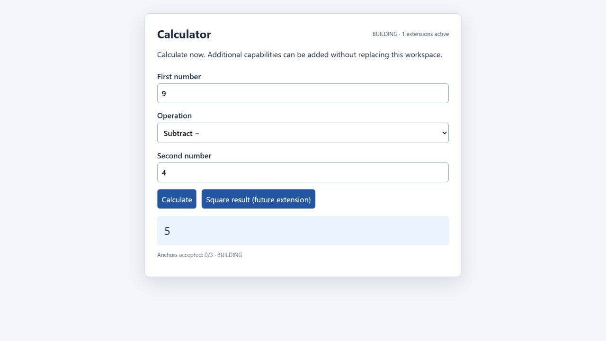

# Canvas construction measurements

The shared MantleOS/KPP chat workflow opens a useful BUILDING app before later
stages, keeps its state alive during refinement, and continues Chase over the
pinned recipe's unmet obligations. [The build guide](../../docs/canvas-builds.md)
describes its host API and explicit acceptance boundaries.

The earlier chat contract included a whole compiled Notepad example in every
construction frame. It now carries the small shared build rule and loads an
example only on explicit request. The measured Notepad packet shrank from
215,779 to 3,245 JSON bytes (98.50%). A real synthetic Engram's ORIENT/RESPOND
frames and chat projection were checked for the new rule.

Public launch operations now reuse their verified sections within each call.
Every later launch still rechecks source pins, exact program/HTML/Python/bridge
relationships and payload integrity. There is no persistent validation cache.

## Matched experiment

Windows x64, CPython 3.14.2, seven alternating fresh-process pairs after one
discarded warmup pair. Identical `.anchor`, HTML and wrapper-preview bytes are
required on both sides. Raw timings, source hashes and harness identity are in
[measurement.json](measurement.json).

| Local operation | Baseline median | Candidate median | Less elapsed time |
| --- | ---: | ---: | ---: |
| Notepad browser preparation | 73.35 ms | 20.37 ms | 72.23% |
| Larger HTML browser preparation | 174.06 ms | 55.46 ms | 68.14% |
| Notepad native launch preparation | 98.35 ms | 20.17 ms | 79.49% |
| Larger HTML native launch preparation | 228.91 ms | 55.16 ms | 75.90% |
| Notepad file delivery | 278.37 ms | 215.96 ms | 22.42% |
| Larger HTML file delivery | 361.96 ms | 236.52 ms | 34.65% |

Portable materialization stays about 2–3 ms; the larger fixture has a small
0.78% timing regression in that stage. No general speedup is claimed for it.
Stage timings include the named operation; process totals additionally include
Python startup/imports. Working-copy construction is outside these timings.

To repeat, extract the preceding a5 source's `src` into a separate baseline path
and compare its recorded source hashes before interpreting the result:

```console
python -S tools/benchmark_canvas.py --baseline-src BASELINE/src --candidate-src src --pairs 7 --output NEW.json
```

These are local preparation measurements. They do not measure live model
generation, network latency or ChatGPT Canvas mounting. The staged host workflow
removes the requirement to finish the whole portable document before showing
the first useful interface; receiving-model compliance remains host-dependent.

## Actual staged browser check

The calculator accepted useful input while BUILDING, before the square extension
was installed. The extension arrived in the same mounted page, preserving 9, 4,
the subtraction selection and the displayed 5. Square produced 25; the original
subtraction still produced 5. The app retained all three unaccepted requirements.
[The observations](browser-checks.json) are scoped to that real browser fixture.



The combined suite ran 298 tests (294 passed, four unavailable-symlink skips).
Standalone KPP ran 191 (187 passed, four skips), plus doctor/smoke/inventory and
six JavaScript syntax checks. Twelve new shared regressions cover loading,
preview-before-refinement order, continued pursuit, dependencies, review/budget
stops, recipe drift, tamper refusal and isolated carried-Body tooling. No product
Baker approval follows from those checks. Live LLMs, other Python versions and
platforms, the full optional Playwright probes and real Hermes requalification
were not run. Full records are in [the verification ledger](../../docs/verification.md).
